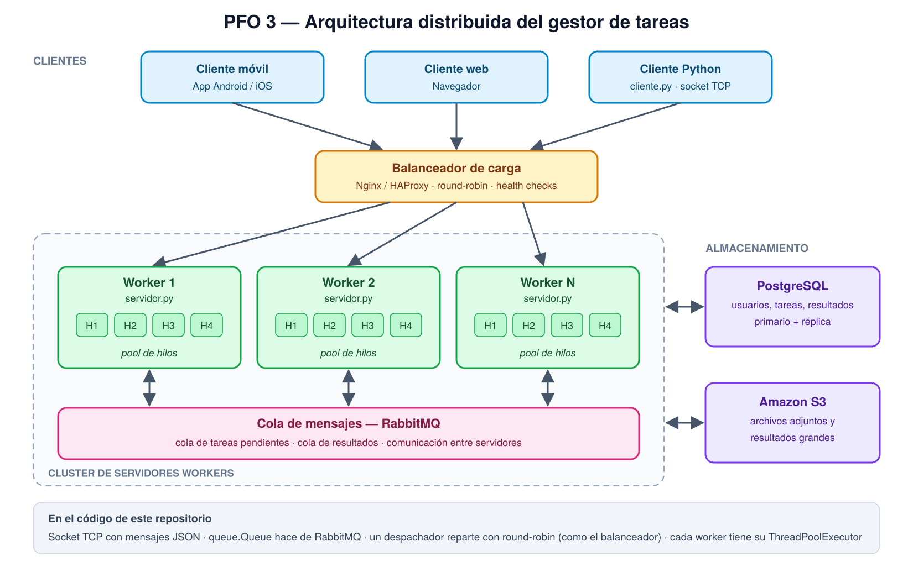

# PFO 3 — Rediseño como Sistema Distribuido (Cliente-Servidor)

**Materia:** Programación sobre Redes — Tecnicatura Superior en Desarrollo de Software
**Alumno:** Guillermo Benítez

Rediseño del gestor de tareas como una arquitectura distribuida. Incluye el diagrama del sistema y una implementación en Python con **sockets TCP**: un servidor que recibe tareas y las distribuye entre workers (cada uno con su pool de hilos) y un cliente que envía tareas y recibe los resultados.

---

## 1. Diagrama del sistema



| Componente | Tecnología | Función |
|---|---|---|
| Clientes | App móvil, navegador, `cliente.py` | Envían tareas y reciben resultados |
| Balanceador de carga | Nginx / HAProxy | Reparte las conexiones entre los workers (round-robin) y deja de enviar tráfico a los que no responden (health checks) |
| Servidores workers | `servidor.py` | Procesan las tareas; cada uno tiene un **pool de hilos** para atender varias a la vez |
| Cola de mensajes | RabbitMQ | Comunica a los servidores entre sí: tareas pendientes y resultados viajan como mensajes, sin que un worker dependa directamente de otro |
| Almacenamiento distribuido | PostgreSQL + Amazon S3 | PostgreSQL guarda datos estructurados (usuarios, tareas, resultados) con réplica; S3 guarda archivos y resultados grandes |

### Flujo de una tarea

1. El cliente abre una conexión y envía la tarea.
2. El balanceador la dirige a uno de los workers.
3. La tarea entra en la cola de mensajes.
4. Un hilo libre de algún worker la toma y la ejecuta.
5. El resultado se guarda (si corresponde) y vuelve al cliente por la misma conexión.

### Del diagrama al código

La implementación corre en una sola máquina, así que cada pieza del diagrama tiene su equivalente local:

| En el diagrama | En `servidor.py` |
|---|---|
| Balanceador de carga | Despachador que reparte con `itertools.cycle` (round-robin) |
| Servidores workers | Clase `Worker` (3 por defecto) |
| Pool de hilos de cada worker | `ThreadPoolExecutor` propio de cada `Worker` (2 hilos por defecto) |
| RabbitMQ | `queue.Queue`, segura para usar desde varios hilos |
| Conexión cliente-servidor | Socket TCP; un hilo por cliente conectado |

---

## 2. Implementación

### Estructura

```
├── servidor.py     # Servidor: recibe tareas por socket y las distribuye a workers
├── cliente.py      # Cliente: envía tareas y muestra los resultados
├── diagrama.svg    # Diagrama del sistema (vectorial)
├── diagrama.png    # Diagrama del sistema (imagen)
└── README.md
```

No usa librerías externas: solo la biblioteca estándar de Python (`socket`, `threading`, `queue`, `concurrent.futures`, `json`).

### Protocolo

Cada mensaje es un objeto JSON terminado en salto de línea (`\n`). Como TCP es un flujo de bytes y no respeta límites de mensajes, el salto de línea marca dónde termina cada uno.

```json
// cliente -> servidor
{"id": 6, "tipo": "factorial", "datos": 25}

// servidor -> cliente
{"id": 6, "worker": "worker-3", "resultado": "15511210043330985984000000",
 "estado": "ok", "duracion_seg": 0.0}
```

El `id` permite al cliente saber a qué tarea corresponde cada respuesta, porque **los resultados llegan en el orden en que terminan, no en el que se enviaron**.

### Tipos de tarea

| Tipo | Datos | Resultado |
|---|---|---|
| `eco` | texto | el mismo texto |
| `mayusculas` | texto | el texto en mayúsculas |
| `contar_palabras` | texto | cantidad de palabras |
| `suma` | lista de números | la suma |
| `factorial` | entero de 0 a 1000 | n! |
| `primos` | entero de 0 a 1.000.000 | cantidad de primos ≤ n |
| `esperar` | segundos de 0 a 10 | simula una tarea lenta |

Si el tipo no existe o los datos no son válidos, el servidor responde con `"estado": "error"` y un mensaje, sin cortar la conexión.

---

## 3. Instalación y ejecución

**Requisitos:** Python 3.9 o superior.

```bash
git clone https://github.com/guillermohbenitez/<nombre-del-repo>.git
cd <nombre-del-repo>
```

**Terminal 1 — servidor**

```bash
python servidor.py
```

Opciones: `--host`, `--puerto` (5000), `--workers` (3), `--hilos` (2 por worker). Se detiene con `Ctrl+C` y muestra cuántas tareas procesó cada worker.

**Terminal 2 — cliente**

```bash
python cliente.py          # menú interactivo
python cliente.py --demo   # envía un lote de 10 tareas de ejemplo
```

---

## 4. Resultado esperado del modo demo

```
  <- tarea 4 [worker-1, 0.0 s]: PROGRAMACIÓN SOBRE REDES
  <- tarea 5 [worker-2, 0.0 s]: 60.5
  <- tarea 6 [worker-3, 0.0 s]: 15511210043330985984000000
  <- tarea 9 [worker-3, 0.0 s]: hola servidor
  <- tarea 7 [worker-1, 0.0008 s]: 9592
  <- tarea 10 ERROR: tipo de tarea desconocido: 'tarea_inexistente'
  <- tarea 8 [worker-2, 0.0 s]: 7
  <- tarea 1 [worker-1, 2.0002 s]: esperé 2.0 s
  <- tarea 2 [worker-2, 2.0001 s]: esperé 2.0 s
  <- tarea 3 [worker-3, 2.0002 s]: esperé 2.0 s

Lote completo en 2.00 s
```

Qué muestra:

- **Distribución:** las tareas se reparten entre `worker-1`, `worker-2` y `worker-3`.
- **Concurrencia:** las tres tareas `esperar(2)` corren en paralelo, así que el lote tarda 2 s y no 6 s.
- **Respuestas asíncronas:** las tareas rápidas (4 a 10) llegan antes que las lentas (1 a 3), aunque se enviaron después.

También se puede abrir más de un cliente a la vez: el servidor atiende a cada uno en su propio hilo.

---

## 5. Cómo escalaría a producción

- Correr varias instancias de `servidor.py` en distintas máquinas detrás de Nginx o HAProxy.
- Reemplazar `queue.Queue` por RabbitMQ (por ejemplo con la librería `pika`), para que la cola sea compartida entre todos los servidores y sobreviva si uno se cae.
- Guardar tareas y resultados en PostgreSQL y los archivos grandes en S3.
- Agregar autenticación (como en el PFO 2) y cifrado TLS en las conexiones.
